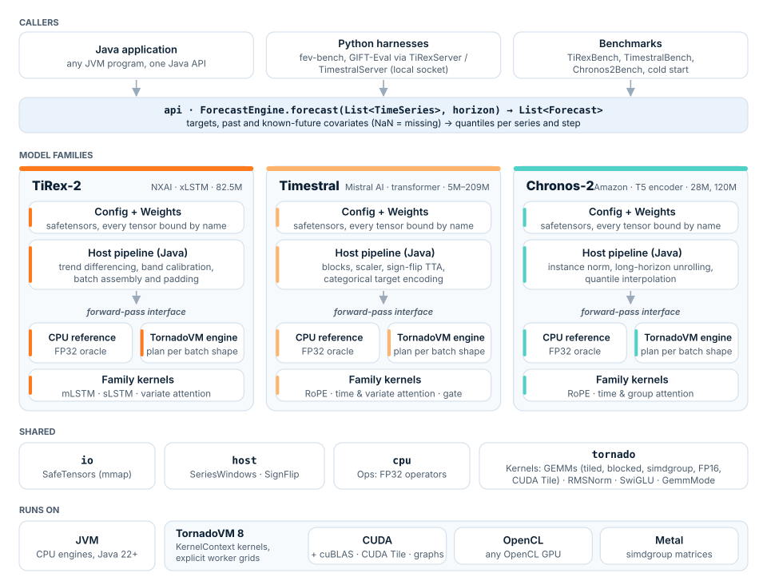

<p align="center">
  <picture>
    <source media="(prefers-color-scheme: dark)" srcset="docs/images/jitcast-logo-dark.svg">
    
  </picture>
</p>

<p align="center">
  <a href="LICENSE"></a>
  
  
</p>

# jitcast

**jitcast** runs zero-shot time-series foundation models in Java, on GPUs through
[TornadoVM](https://github.com/beehive-lab/TornadoVM). Each model reproduces its reference engine's
`forecast()` end to end behind one Java API: the host pipeline (batching, scaling, decoding,
calibration, test-time augmentation) in Java, the forward pass on the GPU.

| Model | From | Sizes | Forecasts | Inputs |
|---|---|---|---|---|
| [**TiRex-2**](docs/models/TIREX2.md) | [NXAI](https://github.com/NX-AI/tirex-2) | 82.5M (xLSTM) | 9 quantiles, up to 320 or 928 steps | univariate, multi-target, past and future covariates |
| [**Timestral**](docs/models/TIMESTRAL.md) | [Mistral AI](https://huggingface.co/mistralai/Timestral-5M) | 5M, 28M, 123M, 209M (transformer) | 21 quantiles, any horizon | univariate, multivariate, past and known-future covariates, categorical covariates |
| [**Chronos-2**](docs/models/CHRONOS2.md) | [Amazon](https://huggingface.co/amazon/chronos-2) | 28M, 120M (T5-style encoder) | 13 or 21 quantiles, any horizon | univariate, multivariate, past and known-future covariates, cross-learning |

- **Portable.** Every kernel is a TornadoVM `KernelContext` kernel: one code base for CUDA, OpenCL
  and Metal.
- **Uses the vendor libraries where they exist.** On NVIDIA, GEMMs can run on cuBLAS (FP32, TF32 or
  FP16 tensor cores) and each forward pass replays as a CUDA graph; on Apple GPUs, on the simdgroup
  matrix units.
- **Checked against the references.** Every stage of every model is tested against the reference
  engine's own activations, on every backend. Validation and benchmarks live in
  [jitCast-benchmarking](https://github.com/beestream-ai/jitCast-benchmarking).

## Architecture

<p align="center">
  
</p>

The forward pass runs either on the CPU reference, the FP32 oracle the device kernels are tested
against, or on a TornadoVM device as one compiled plan per batch shape. More in
[DEVELOPMENT.md](docs/DEVELOPMENT.md#architecture).

## Quick start

You need JDK 22+ and a TornadoVM 8 SDK (`jdk22plus` family); details in [INSTALL.md](docs/INSTALL.md).

```bash
sdk install java 25.0.4-tem                     # any JDK 22+
sdk install tornadovm 8.0.0-jdk22plus-cuda      # or ...-metal / ...-opencl
tornado --devices                               # device ids, as <backend>:<device>

git clone https://github.com/beestream-ai/jitcast && cd jitcast
./mvnw -q package -DskipTests

mkdir -p Timestral-5M && for f in config.json model.safetensors; do
  curl -L -o Timestral-5M/$f https://huggingface.co/mistralai/Timestral-5M/resolve/main/$f
done
```

The same call forecasts with every model:

```java
try (ForecastEngine engine = TornadoTimestralEngine.load(Path.of("Timestral-5M"))) {  // or TornadoChronos2Engine, TornadoTiRex2Engine
    List<Forecast> forecasts = engine.forecast(List.of(TimeSeries.univariate(history)), 64);
    float[] median = forecasts.get(0).median(0);        // values[target][quantile][step]
}
```

```bash
java @$TORNADOVM_HOME/tornado-argfile -cp target/classes:<your app> -Djitcast.tornado.device=0:0 your.Main
```

## Where it runs

| Platform | Backend | TiRex-2 | Timestral | Chronos-2 |
|---|---|---|---|---|
| NVIDIA GPU (tested: A100, A10, RTX 5070 Ti) | CUDA | validated | validated | validated |
| NVIDIA GPU | OpenCL | validated | validated | not tested |
| Apple Silicon (tested: M4 Pro) | Metal, OpenCL | validated | validated | validated |
| Intel, AMD GPUs | OpenCL | expected to work | expected to work | expected to work |
| Any CPU | plain JVM | FP32 reference | FP32 reference | FP32 reference |

The CPU engines are reference implementations for validation, not fast paths. Prefer CUDA on NVIDIA
and Metal on Apple Silicon: OpenCL runs the same kernels without the vendor libraries.

## Performance flags

The defaults are accurate to FP32 and fast on every platform. These flags trade some of that for
speed, or fit the engine to a workload.

| Where | Flag | Effect |
|---|---|---|
| NVIDIA | `-Dtirex.tornado.gemm=cublas-auto` | TiRex-2's fastest mode: FP16 tensor-core GEMMs, FP32 residual stream |
| NVIDIA | `-Dtimestral.tornado.gemm=cublas-fp16`, `-Dchronos2.tornado.gemm=cublas-fp16` | FP16 tensor-core GEMMs; forecasts move slightly off the FP32 reference |
| NVIDIA, no vendor libraries | `-Dtirex.tornado.gemm=cutile` | TornadoVM's own FP16 GEMM on tensor cores (CUDA Toolkit 13.3+) |
| Apple Silicon | `-Dtirex.tornado.gemm=half` | TiRex-2's FP16 GEMM, faster than the FP32 default |
| Apple Silicon, SDK with Metal and OpenCL | `-Dtornado.metal.priority=100` | Makes Metal the default backend, which enables the simdgroup GEMMs of Timestral and Chronos-2 |
| Any GPU | `-Dtornado.device.memory=<most of the GPU>` (e.g. `20GB`) | TornadoVM caps device memory at 4 GB by default; a larger cap keeps more compiled plans and allows bigger batches |
| Any GPU | `-D<model>.tornado.plans=<n>` | More batch shapes kept compiled, so recurring shapes skip recompilation |
| Many different batch sizes | `-Dtirex.tornado.rowBuckets=pow2` | TiRex-2 pads row counts to powers of two, so sizes share plans |

Calls with many series amortise the per-call cost best: pass a whole batch to one `forecast()` call
rather than one series at a time. Every option, with per-model recommendations, is in
[CONFIGURATION.md](docs/CONFIGURATION.md).

## Documentation

| Document | Contents |
|---|---|
| [INSTALL.md](docs/INSTALL.md) | TornadoVM SDKs, device numbering, NVIDIA extras, building, weights |
| [USAGE.md](docs/USAGE.md) | The Java API, the benchmark tools, the harness servers, the tests |
| [CONFIGURATION.md](docs/CONFIGURATION.md) | Every option, GEMM modes, recommendations per platform |
| [TIREX2.md](docs/models/TIREX2.md), [TIMESTRAL.md](docs/models/TIMESTRAL.md), [CHRONOS2.md](docs/models/CHRONOS2.md) | Each model: architecture, checkpoints, features, mapping onto jitcast, licence |
| [KERNELS.md](docs/KERNELS.md) | Every device kernel and its vendor-library alternative |
| [DEVELOPMENT.md](docs/DEVELOPMENT.md) | Architecture, code layout, adding a model family, scripts |
| [ROADMAP.md](docs/ROADMAP.md) | Planned work and the TornadoVM limits that affect jitcast |
| [jitCast-benchmarking](https://github.com/beestream-ai/jitCast-benchmarking) | Validation, benchmark harnesses and results |

## License

jitcast is released under the [Apache License, Version 2.0](LICENSE). Copyright (c) 2026 Beestream Ltd.
`util/Json.java` is derived from [jitllm](https://github.com/beehive-lab/jitllm) (MIT); see [NOTICE](NOTICE).

The model weights are their authors' and jitcast does not distribute them: TiRex-2's are NX-AI's,
under their own terms; Timestral's are Mistral AI's, under a Modified MIT licence with a revenue
restriction ([TIMESTRAL.md](docs/models/TIMESTRAL.md#licence)); Chronos-2's are Amazon's, under
Apache 2.0.
